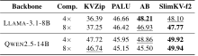
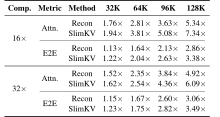

# SlimKV

**Joint Token-Feature KV Cache Compression with Reconstruction-Free Beacon Attention**

**EMNLP 2026 Main Conference (Oral)**

[Paper](https://arxiv.org/abs/2610.02953) · [Code](https://github.com/Strandding/SlimKV) · [中文](README.zh-CN.md)

## Overview

SlimKV compresses both the number of cached tokens and their feature dimensions for long-context LLM inference. It learns compact Beacon memories with layer-adaptive low-rank K/V representations, improving the accuracy–memory trade-off under a fixed cache budget.

Conventional feature compression often reconstructs full-dimensional Keys before applying RoPE. We find that Beacon Keys are much less sensitive to removing key-side RoPE than raw-token Keys. SlimKV trains low-rank Beacon projections under this constraint while retaining RoPE for raw-token Keys and all Queries. This positional asymmetry enables reconstruction-free latent-space attention during decoding.

On LongBench, SlimKV retains over 96% of the full-cache score at 4× and 8× compression and outperforms the evaluated baselines at 16× and 32×. At 128K context length, the t4f4 configuration achieves 7.34× attention speedup and 3.38× end-to-end decoding speedup over Full KV.

## Method


SlimKV progressively compresses completed context windows into Beacon memories. Its K/V projections are trained directly at the target rank, with the backbone frozen. Layer-adaptive ranks account for differences in low-rank structure across layers rather than assigning every layer the same capacity.

During decoding, attention scores and value aggregation operate on cached latent Beacon states. Queries are projected into the latent Key space, and attention outputs are projected back through the Value basis. This avoids reconstructing the historical Beacon K/V. Raw-token tails and sinks retain full-dimensional K/V.


*Removing K-RoPE from raw-token Keys causes substantial degradation. Beacon Keys are less sensitive, and SlimKV learns low-rank memories without Beacon K-RoPE (Figure 2).*

## Results

| **96%+** | **7.34×** | **3.38×** |
|:---:|:---:|:---:|
| Full KV LongBench score retained at 4× / 8× compression | Attention speedup at 128K | End-to-end decoding speedup at 128K |

The speedups above use t4f4 on Llama-3.1-8B, measured with BF16 eager execution on an A100 80GB. Full results and the evaluation protocol are in the [paper](https://arxiv.org/abs/2610.02953).



*LongBench averages at 4× and 8× compression (Table 4). AB denotes Activation Beacon.*



*Attention and per-token decoding speedups across 32K–128K contexts (Table 6).*

Benchmark scripts and local H20 FA2 measurements are documented in [benchmarking](docs/benchmark.md).

## Installation

Use Python 3.11 and install a PyTorch build that matches your hardware, then:

```bash
git clone https://github.com/Strandding/SlimKV.git
cd SlimKV
python -m pip install -e .
```

The model code uses Transformers 4.40.x, tested with 4.40.2. Eager inference does not require FlashAttention. See [installation](docs/installation.md) for training dependencies and the optional FA2 extension.

## Usage

Provide a trained SlimKV checkpoint containing the weights, configuration and tokenizer. Checkpoints are not yet publicly hosted. See [training](docs/training.md) to initialize and train one.

```bash
python -m main.infer \
  --model_name_or_path /path/to/slimkv-checkpoint \
  --prompt 'Explain why a KV cache helps language model inference.' \
  --max_new_tokens 32
```

Use `--prompt_file /path/to/context.txt` for a long context. The example reads ranks and Beacon settings from the checkpoint and runs greedy BF16 inference on `cuda:0`.

The default backend stores latent Beacon K/V and reconstructs them for attention. Llama3 also supports optional reconstruction-free FA2 decode. Training and prefill use the original attention dimension. See [quick start](docs/quickstart.md) for the Python API and backend options.

## Reproduction

Run the following entry points from the repository root. Model, data and output paths can be set through the environment variables in [.env.example](.env.example).

| Stage | Entry point | Guide |
|---|---|---|
| Low-rank initialization | `python -m main.convert_kv_lowrank --help` | [Training](docs/training.md) |
| Pretraining | `bash scripts/training/train_llama_8B.sh` | [Training](docs/training.md) |
| Finetuning | `bash scripts/training/finetune_llama_8B.sh` | [Training](docs/training.md) |
| LongBench | `python -m main.eval_longbench --help` | [Evaluation](docs/evaluation.md) |
| Needle-in-a-Haystack | `python -m main.eval_needle --help` | [Evaluation](docs/evaluation.md) |
| Latency and memory | `python -m tools.benchmark_fa2_decode --help` | [Benchmarking](docs/benchmark.md) |

Final checkpoints and processed training-data manifests still need to be released. The [reproduction guide](docs/reproducibility.md) lists the required resources and experiment protocols. A [source map](docs/structure.md) explains the modules, and [implementation status](docs/implementation_status.md) tracks the remaining paper components.

## Citation

```bibtex
@misc{teng2026slimkv,
  title = {SlimKV: Joint Token-Feature KV Cache Compression with Reconstruction-Free Beacon Attention},
  author = {Teng, Zihan and Zhao, Jiayu and Ren, Wentao and Fan, Minhao and Ma, Tianrui and Chen, Song and Liu, Weichen},
  year = {2026},
  eprint = {2610.02953},
  archivePrefix = {arXiv},
  primaryClass = {cs.LG},
  url = {https://arxiv.org/abs/2610.02953}
}
```

## Acknowledgements and license

SlimKV builds on [Activation Beacon](https://github.com/FlagOpen/FlagEmbedding/tree/master/research/Long_LLM/activation_beacon), Hugging Face Transformers and [FlashAttention](https://github.com/Dao-AILab/flash-attention). See [third-party notices](THIRD_PARTY_NOTICES.md) for attribution and licenses. The license for original SlimKV contributions is pending.
