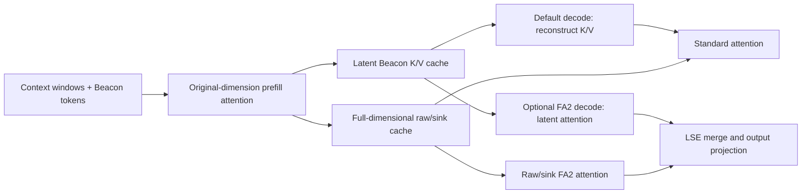

# SlimKV: Joint Token-Feature KV Cache Compression with Reconstruction-Free Beacon Attention

[中文](README.zh-CN.md)

SlimKV learns compact Beacon memories to reduce both the number and feature dimensions of cached tokens for long-context language models.

[Code](https://github.com/Strandding/SlimKV) · [Quick start](docs/quickstart.md) · [Reproduction guide](docs/reproducibility.md) · [Implementation status](docs/implementation_status.md)

**Release status:** research implementation. A public paper URL, downloadable SlimKV checkpoints, and publication venue have not been confirmed. The manuscript results below are not claims of complete reproduction by this checkout.

## Overview

SlimKV combines three designs:

- **Joint token-feature compression:** progressive Beacon tokens summarize completed context windows; low-rank K/V projections shrink each retained Beacon state.
- **Layer-adaptive representations:** different K/V ranks allocate capacity across layers under a feature budget. This repository accepts explicit rank lists and initializes them with SVD; the paper's automatic budget allocator is not implemented.
- **Reconstruction-free Beacon attention:** Beacon Keys omit K-side RoPE, allowing queries and attention outputs to be projected around latent K/V attention. Raw-token Keys and all Queries retain RoPE.

**Current execution paths:** training and prefill compute attention in the original head dimension. Compatible Llama3 inference stores latent Beacon K/V; the default decode backend reconstructs them before attention. An optional `fa2` decode backend computes directly over global latent Beacon K/V and combines this with full-dimensional raw/sink attention. Qwen2 low-rank training is available, but its ordinary inference cache remains full-dimensional. See [supported configurations and limitations](docs/implementation_status.md).

## Method overview


Figure 3 from the supplied manuscript shows the paper design. The schematic below distinguishes the current reconstruction and optional latent decode paths.

The diagram describes current Llama3 inference; raw tails and sinks remain full-dimensional.



The schematic is derived from the implementation; the paper figure does not imply that all manuscript experiments have been reproduced.

## Main results

**Reported in the supplied manuscript**, Tables 2 and 6 and §5.4; full reproduction is pending:

| Measurement | Llama-3.1-8B | Qwen2.5-14B |
|---|---:|---:|
| LongBench average, Full KV | 49.50 | 51.52 |
| SlimKV-f4, nominal 16× compression (t4f4) | 46.36 | 46.23 |
| SlimKV-f4, nominal 32× compression (t8f4) | 44.75 | 45.09 |
| Attention speedup, t4f4 at 128K | 7.34× | — |
| Per-token decode speedup, t4f4 at 128K | 3.38× | — |
| Peak-memory reduction, t4f4 / t8f4 at 11.5K | 2.71× / 2.82× | — |

The paper's efficiency protocol uses A100 80GB, B1, BF16, eager attention, and synthetic Full KV at long lengths. These numbers do not describe the H20 FA2 backend. Token × feature compression is nominal: raw tails and sinks reduce the realized cache ratio.

**Repository validation only:** on H20, the local f4 BF16 checkpoint was tested on eight LongBench-v1 samples and two timing fixtures. With standard FA2 prefill, partial CUDA Graph decode measured 18.38 / 18.67 ms/token for 4,009 / 6,194-token inputs; the same-run compact full-cache control measured 26.34 / 26.40 ms/token. Graph adds about 515.75 MiB of live allocation in this B1 test. These are local smoke/scaling results, not a full LongBench score or reproduction of paper efficiency. [Protocol, tables, and evidence](docs/benchmark.md).

## Installation

Use Python 3.11 in a separate environment. Install a PyTorch build for your machine first, then:

```bash
git clone https://github.com/Strandding/SlimKV.git
cd SlimKV
python -m pip install -e .
python -m pip check
```

The model implementation requires Transformers **4.40.x** (tested with 4.40.2). The minimal eager example does not require FlashAttention. Training and FA2 kernels have separate requirements: [installation guide](docs/installation.md).

## Quick start

Supply a **trained SlimKV checkpoint**, including `config.json`, weights, and tokenizer files. A base Llama checkpoint alone does not provide trained SlimKV projections. No public SlimKV weight download is currently available in this repository; obtain the checkpoint from the authors or train one using the guide.

```bash
python -m main.infer \
  --model_name_or_path /path/to/slimkv-checkpoint \
  --prompt 'Explain why a KV cache helps language model inference.' \
  --max_new_tokens 32
```

This uses BF16 on `cuda:0`, eager attention and the reconstruction backend, preserving the checkpoint's ranks and Beacon schedule. Use `--prompt_file` for a long UTF-8 context. Short prompts may not create a completed Beacon window. [Python API, CPU options, and optional FA2 decode](docs/quickstart.md).

## Reproducing the paper

Run commands from the repository root. Launcher paths are configurable through [.env.example](.env.example), which is not automatically loaded.

| Stage | Entry point | Instructions |
|---|---|---|
| Low-rank initialization | `python -m main.convert_kv_lowrank --help` | [SVD and rank lists](docs/training.md) |
| Pretraining | `bash scripts/training/train_llama_8B.sh` | [Data, settings, resources](docs/training.md) |
| Finetuning | `bash scripts/training/finetune_llama_8B.sh` | [Training stages](docs/training.md) |
| LongBench-v1 | `python -m main.eval_longbench --help` | [Full evaluation and smoke subset](docs/evaluation.md) |
| Retrieval / accuracy | `python -m main.eval_needle --help` | [Accuracy coverage](docs/evaluation.md) |
| Latency / memory | `python -m tools.benchmark_fa2_decode --help` | [Measured protocol](docs/benchmark.md) |

These are runnable entry points, not an assertion that the paper is fully reproducible. Missing weights, training-data manifests, automatic rank allocation, and paper-specific efficiency/judge protocols are listed in [reproducibility](docs/reproducibility.md).

## Repository structure

```text
slimkv/                     Model loading, configuration, Memory and training utilities
  llama3/                   Low-rank Llama3, latent cache and optional FA2 decode
  qwen2/                    Low-rank Qwen2/Qwen2.5 training; full-dimensional cache
  latency/                  Independent research prototype; separate loader and semantics
main/                       python -m main.<command> entry points, including infer
scripts/                    conversion/, training/, evaluation/, benchmark/, slurm/, vllm/
config/                     Data mixtures and distributed-training configurations
kernels/fa2_decode/          BF16 SM90 width-320 forward extension
tools/                     Validation, benchmark, provenance and hardware utilities
tests/                     CPU regression tests; GPU validation lives in tools/
docs/                      Guides, implementation status and archived experiment notes
experiments/anchor_prototype/  Preserved early implementation; excluded from installation
 requirements/              CPU CI constraints
 data/toy/                  Small tracked example; other data/results/weights stay local
```

See [module and tool map](docs/structure.md) and [refresh validation](docs/results/repository_validation_20261014.json). Run CPU checks with `python tools/check_repository.py` and `python -m unittest discover -s tests -v`.

## Citation

The author list is taken from the supplied manuscript. Publication metadata is pending; no venue, DOI, or arXiv identifier is inferred.

```bibtex
@unpublished{teng_slimkv,
  title = {SlimKV: Joint Token-Feature KV Cache Compression with Reconstruction-Free Beacon Attention},
  author = {Teng, Zihan and Zhao, Jiayu and Ren, Wentao and Fan, Minhao and Ma, Tianrui and Chen, Song and Liu, Weichen},
  note = {Unpublished manuscript}
}
```

Machine-readable citation metadata is in [CITATION.cff](CITATION.cff).

## Acknowledgements and license

SlimKV builds on [Activation Beacon](https://github.com/FlagOpen/FlagEmbedding/tree/master/research/Long_LLM/activation_beacon), Hugging Face Transformers, and [FlashAttention](https://github.com/Dao-AILab/flash-attention). Upstream copyright notices are retained. See [third-party notices](THIRD_PARTY_NOTICES.md) for bundled license texts.

**The license for original SlimKV contributions has not yet been specified by the authors.** This refresh does not select a project license. Upstream licenses apply to their respective components; model weights and datasets retain their own terms.
