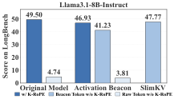
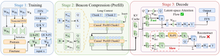

<h1 align="center">SlimKV</h1>

<p align="center"><strong>联合 Token–Feature KV Cache 压缩与无需重建的 Beacon 注意力</strong></p>
<p align="center"><em>EMNLP 2026 Main Conference（Oral）</em></p>

<p align="center">
  <a href="https://arxiv.org/abs/2610.02953"></a>
  <a href="https://arxiv.org/abs/2610.02953"></a>
  <a href="https://github.com/Strandding/SlimKV/actions/workflows/ci.yml"></a>
  <a href="../../LICENSE"></a>
</p>

<p align="center">
  <a href="#动态">动态</a> ·
  <a href="#概览">概览</a> ·
  <a href="#方法">方法</a> ·
  <a href="#结果">结果</a> ·
  <a href="#安装">安装</a> ·
  <a href="#使用">使用</a> ·
  <a href="#复现">复现</a> ·
  <a href="#引用">引用</a>
</p>

<p align="center">
  <a href="https://arxiv.org/abs/2610.02953">论文</a> ·
  <a href="https://github.com/Strandding/SlimKV">代码</a> ·
  <a href="../../README.md">English</a>
</p>

## 动态

- **2026-10-14:** 已提供[推理](quickstart.md)、[训练](training.md)、[评测](evaluation.md)和[性能测试](benchmark.md)指南。
- **2026-10-02:** 论文公开于 [arXiv](https://arxiv.org/abs/2610.02953)。

## 概览

SlimKV 同时压缩 KV Cache 的 token 数量和特征维度，用于长上下文大模型推理。它通过训练紧凑的 Beacon 记忆和逐层自适应低秩 K/V 表示，在固定缓存预算下改善精度与显存之间的权衡。

在 LongBench 上，SlimKV 在16×和32×压缩下优于所评测的基线，并在4×和8×压缩下保留超过96%的 Full KV 得分。128K上下文下，4× token / 4× 特征配置实现7.34×注意力 kernel 加速和3.38×端到端decode加速。

## 方法

传统特征压缩通常需要先重建完整维度的 Key，再应用 RoPE。我们发现，去掉 key-side RoPE 对 Beacon Keys 的影响显著小于对 raw-token Keys 的影响。SlimKV 利用这种**位置不对称性**，在关闭 Beacon K-RoPE 的约束下训练低秩投影，同时保留 raw K 和所有 Q 的 RoPE，从而在 decode 中直接计算 latent-space attention，避免历史 Beacon K/V 的完整维度重建。

<p align="center">
  
</p>

<p align="center"><em>去掉 raw-token K-RoPE 会造成显著退化，Beacon Keys 对此更不敏感。SlimKV 在无 Beacon K-RoPE 的约束下学习低秩记忆（Figure 2）。</em></p>

<p align="center">
  
</p>

SlimKV 将已完成的上下文窗口逐步压缩为 Beacon 记忆。Backbone 保持冻结，Beacon K/V 投影直接在目标低秩约束下训练。逐层 rank 根据各层低秩结构的差异分配容量，而不是给所有层相同维度。

Decode 时，attention scores 和 Value 聚合在缓存的 latent Beacon 状态上完成。Query 投影到 latent Key 空间，attention 输出通过 Value basis 映射回原始空间，因此无需重建历史 Beacon K/V。Raw tail 和 sink 仍保留完整维度缓存。

## 结果

<table align="center">
  <thead>
    <tr>
      <th align="center"><strong>16× / 32×</strong></th>
      <th align="center"><strong>7.34×</strong></th>
      <th align="center"><strong>3.38×</strong></th>
    </tr>
  </thead>
  <tbody>
    <tr>
      <td align="center">高压缩比下领先的 LongBench 结果</td>
      <td align="center">128K 注意力 kernel 加速</td>
      <td align="center">128K 端到端 decode 加速</td>
    </tr>
  </tbody>
</table>

### LongBench 平均分

`f2`、`f4`、`f8` 分别表示 2×、4×、8× 特征压缩。16× 总压缩下，对应的 token 压缩为 8×、4×、2×；32× 下则为 16×、8×、4×。

#### 16× 压缩

<div align="center">

| 方法 | Llama-3.1-8B | Qwen2.5-14B |
| :---: | :---: | :---: |
| **Full KV (1×)** | **49.50** | **51.52** |
| KVZip | 28.96 | 13.18 |
| PALU | 18.92 | 27.70 |
| SnapKV | 45.60 | 45.81 |
| Activation Beacon | 45.30 | 44.15 |
| SlimKV-f2 | 46.19 | **46.48** |
| SlimKV-f4 | **46.36** | 46.23 |
| SlimKV-f8 | 45.05 | 44.33 |

</div>

#### 32× 压缩

<div align="center">

| 方法 | Llama-3.1-8B | Qwen2.5-14B |
| :---: | :---: | :---: |
| **Full KV (1×)** | **49.50** | **51.52** |
| KVZip | 9.40 | 5.12 |
| PALU | 4.79 | 9.25 |
| SnapKV | 43.24 | 42.28 |
| Activation Beacon | 43.67 | 42.76 |
| SlimKV-f2 | 42.91 | 44.66 |
| SlimKV-f4 | **44.75** | **45.09** |
| SlimKV-f8 | 43.93 | 44.69 |

</div>

平均分来自论文 Table 2，Full KV 为未压缩基线；压缩结果中的粗体标出各模型和压缩比下的最佳分数。

<details>
<summary>解码耗时加速比：32K–128K 上下文</summary>

Llama-3.1-8B，A100 80GB，BF16，eager 执行。两项指标分别衡量注意力 kernel 耗时与每 token 端到端解码耗时。表中数值均为 **Full KV 耗时 / 对应方法耗时**，越大越快。Recon 为重建版本，SlimKV 为免重建 latent attention（Table 6）。

#### 16× 压缩：4× token，4× 特征

<div align="center">

| 上下文 | Kernel · Recon | Kernel · SlimKV | 端到端 · Recon | 端到端 · SlimKV |
| :---: | :---: | :---: | :---: | :---: |
| 32K | 1.76× | **1.94×** | 1.13× | **1.22×** |
| 64K | 2.81× | **3.81×** | 1.64× | **2.04×** |
| 96K | 3.63× | **5.08×** | 2.13× | **2.63×** |
| 128K | 5.34× | **7.34×** | 2.86× | **3.38×** |

</div>

#### 32× 压缩：8× token，4× 特征

<div align="center">

| 上下文 | Kernel · Recon | Kernel · SlimKV | 端到端 · Recon | 端到端 · SlimKV |
| :---: | :---: | :---: | :---: | :---: |
| 32K | 1.52× | **1.62×** | 1.15× | **1.23×** |
| 64K | 2.35× | **2.54×** | 1.67× | **1.75×** |
| 96K | 3.84× | **4.36×** | 2.60× | **2.82×** |
| 128K | 4.92× | **6.09×** | 3.06× | **3.49×** |

</div>

</details>

<details>
<summary>4× / 8× 压缩的补充结果</summary>

在较低压缩比下，SlimKV-f2 保留超过96%的 Full KV LongBench 得分。以下是 Table 4 的平均分。

<div align="center">

| 模型 | 压缩比 | KVZip | PALU | Activation Beacon | SlimKV-f2 |
| :---: | :---: | :---: | :---: | :---: | :---: |
| Llama-3.1-8B | 4× | 36.39 | 46.66 | 48.21 | 48.10 |
| Llama-3.1-8B | 8× | 37.25 | 46.42 | 46.93 | 47.77 |
| Qwen2.5-14B | 4× | 47.72 | 45.95 | 48.86 | 49.92 |
| Qwen2.5-14B | 8× | 46.74 | 45.15 | 45.50 | 49.94 |

</div>

</details>

完整实验协议见[论文](https://arxiv.org/abs/2610.02953)，可运行的耗时与显存对照见[性能评测](benchmark.md)。

## 安装

使用 Python 3.11，先安装匹配硬件的 PyTorch，再执行：

```bash
git clone https://github.com/Strandding/SlimKV.git
cd SlimKV
python -m pip install -e .
```

模型代码使用 Transformers 4.40.x，已验证4.40.2。Eager推理不需要 FlashAttention。训练依赖和可选 FA2 扩展见[安装说明](installation.md)。

## 使用

本仓库不提供模型权重。使用已有 SlimKV checkpoint，或按[训练说明](training.md)自行训练。Checkpoint 需包含权重、配置和 tokenizer。

```bash
python -m main.infer \
  --model_name_or_path /path/to/slimkv-checkpoint \
  --prompt 'Explain why a KV cache helps language model inference.' \
  --max_new_tokens 32
```

长上下文使用 `--prompt_file /path/to/context.txt`。示例从 checkpoint 读取 rank 和 Beacon 设置，在 cuda:0 上进行 BF16 greedy 推理。

默认后端存储低维 Beacon K/V，在注意力计算前重建。Llama3 另支持可选的免重建 FA2 decode；训练和 prefill 在原始注意力维度计算。[快速开始](quickstart.md)提供 Python API 和后端选项。

## 复现

从仓库根目录启动，模型、数据和输出路径由 [.env.example](../../.env.example) 中的环境变量配置。

<div align="center">

| 阶段 | 入口 | 说明 |
| :---: | :---: | :---: |
| 低秩初始化 | `python -m main.convert_kv_lowrank --help` | [训练](training.md) |
| 预训练 | `bash scripts/training/train_llama_8B.sh` | [训练](training.md) |
| 微调 | `bash scripts/training/finetune_llama_8B.sh` | [训练](training.md) |
| LongBench | `python -m main.eval_longbench --help` | [评测](evaluation.md) |
| NIAH | `python -m main.eval_needle --help` | [评测](evaluation.md) |
| 耗时与显存 | `python -m tools.benchmark_fa2_decode --help` | [性能评测](benchmark.md) |

</div>

实验协议与所需资源见[复现指南](reproducibility.md)，源码导航见[模块说明](structure.md)，缓存与注意力路径见[后端支持](implementation_status.md)。

## 引用

ACL Anthology 的正式论文记录尚未公开，以下使用临时会议引用并链接 arXiv 版本。

```bibtex
@inproceedings{teng2026slimkv,
  title = {SlimKV: Joint Token-Feature KV Cache Compression with Reconstruction-Free Beacon Attention},
  author = {Teng, Zihan and Zhao, Jiayu and Ren, Wentao and Fan, Minhao and Ma, Tianrui and Chen, Song and Liu, Weichen},
  booktitle = {2026 Conference on Empirical Methods in Natural Language Processing (EMNLP)},
  year = {2026},
  note = {Accepted to the Main Conference (Oral). Provisional conference citation.},
  eprint = {2610.02953},
  archivePrefix = {arXiv},
  primaryClass = {cs.LG},
  url = {https://arxiv.org/abs/2610.02953}
}
```

## 致谢与许可

SlimKV 基于 [Activation Beacon](https://github.com/FlagOpen/FlagEmbedding/tree/master/research/Long_LLM/activation_beacon)、Hugging Face Transformers 和 [FlashAttention](https://github.com/Dao-AILab/flash-attention)。归属和许可见[第三方声明](../../THIRD_PARTY_NOTICES.md)。SlimKV 原创代码采用 [Apache License 2.0](../../LICENSE)。第三方组件保留各自的版权与许可，模型权重和数据集遵循各自的授权条款。
